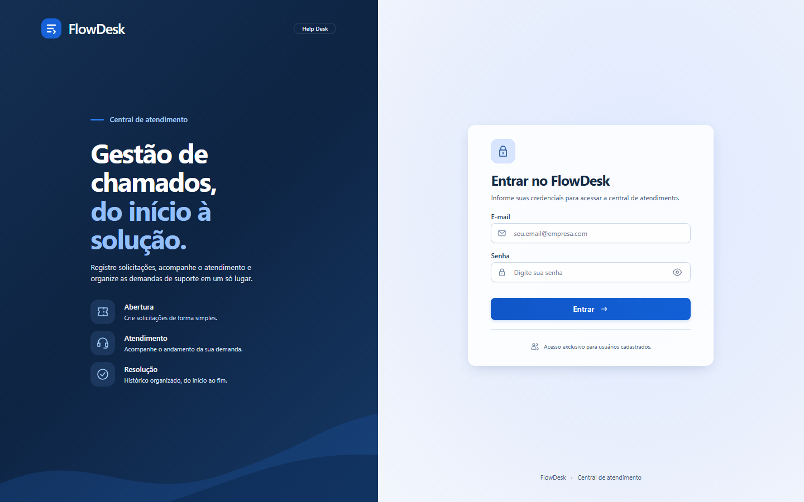
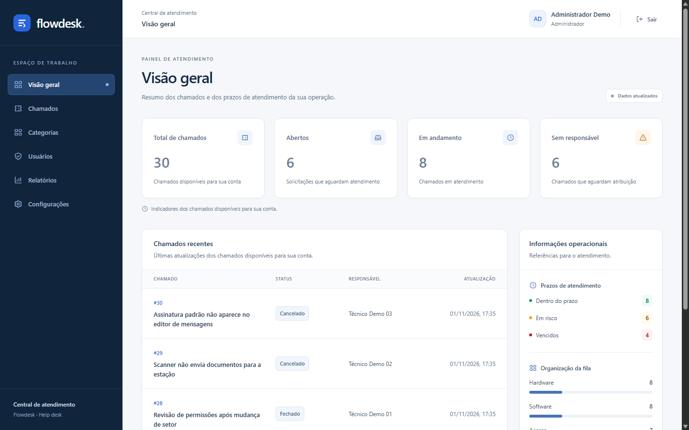
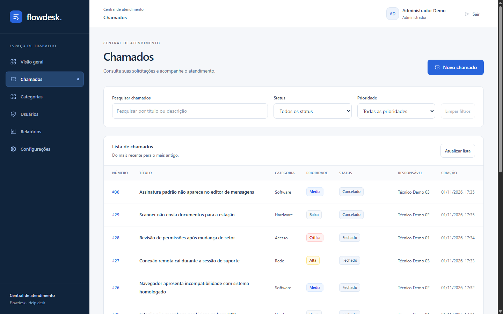
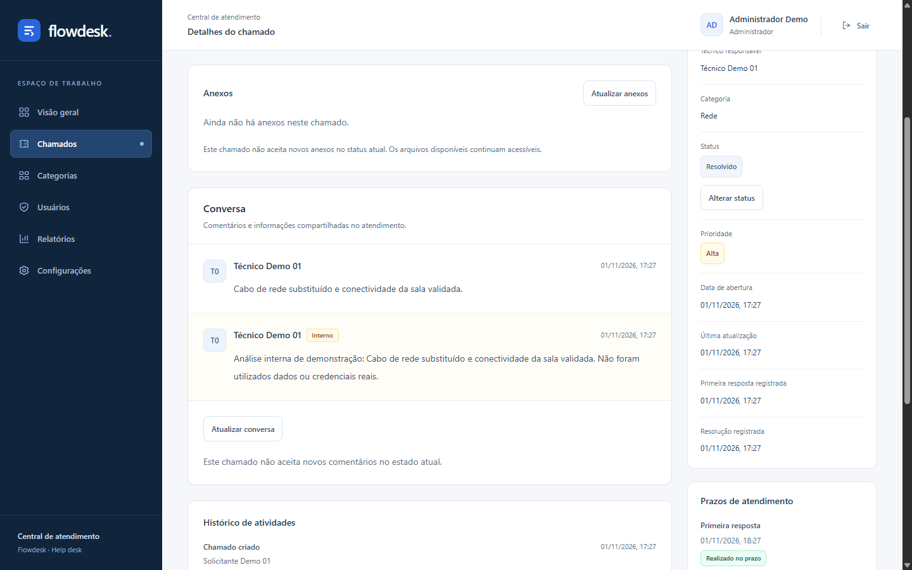
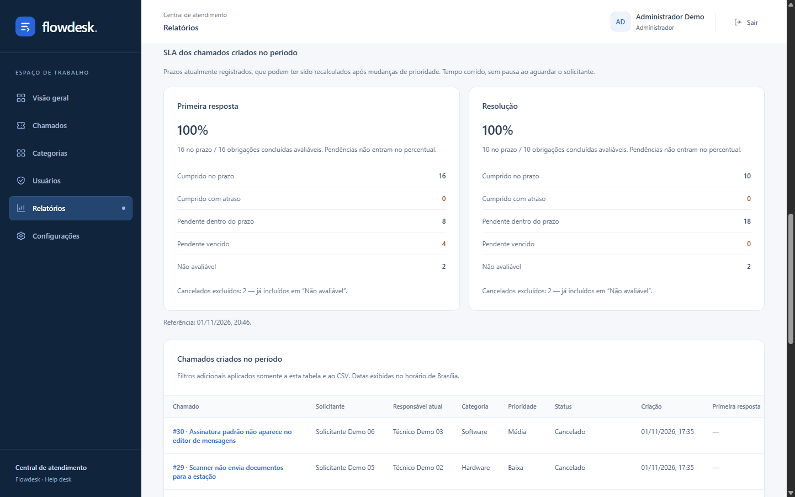
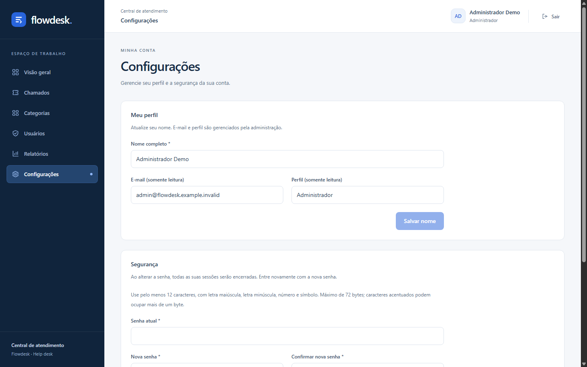

# FlowDesk

Sistema Full Stack de Help Desk desenvolvido com React, TypeScript, Laravel e PostgreSQL.


O FlowDesk é uma aplicação de gerenciamento de chamados de suporte técnico, com controle de acesso por perfil, acompanhamento de SLA, histórico de atendimento e relatórios administrativos.

## Funcionalidades

- Gerenciamento completo de chamados, prioridades e responsáveis.
- Três perfis de acesso: solicitante, técnico e administrador.
- Comentários públicos e internos, histórico e acompanhamento de SLA.
- Dashboard com indicadores e gráficos.
- Upload e download autenticado de anexos privados.
- Relatórios administrativos com filtros e exportação CSV.
- Administração de usuários, categorias e configurações da conta.

## Demonstração

### Login



### Dashboard



### Chamados



### Detalhes do chamado



### Relatórios



### Configurações



*Capturas reais da aplicação utilizando dados fictícios.*

## Tecnologias

| Camada | Tecnologias |
|---|---|
| Frontend | React, TypeScript, Tailwind CSS, Vite |
| Backend | PHP, Laravel, Sanctum |
| Banco de dados | PostgreSQL |
| Infraestrutura | Docker Compose |
| Testes e qualidade | PHPUnit, ESLint, Laravel Pint |

### Arquitetura

```text
Navegador → React → API Laravel → PostgreSQL
                        └─────→ Anexos privados
```

O backend implementa autenticação por sessão, autorização por perfil, validação de dados e controle de concorrência. Banco e anexos utilizam volumes persistentes.

## Executar localmente

**Pré-requisitos:** Git, Docker com Compose, Node.js 24.x e npm. Portas 5173, 8000 e 5433 disponíveis.

Os comandos abaixo são para PowerShell e uma instalação nova. O roteiro foi revisado com o código, mas ainda não foi testado integralmente em um clone limpo.

### 1. Configurar o ambiente

Na raiz do projeto:

```powershell
Copy-Item .env.example .env
Copy-Item backend/.env.example backend/.env
Copy-Item frontend/.env.example frontend/.env
```

Configure a mesma senha `DB_PASSWORD` em `.env` e `backend/.env`. Preserve a conexão PostgreSQL indicada nos exemplos e utilize `VITE_API_URL=http://localhost:8000/api` no frontend.

### 2. Iniciar backend e banco

```powershell
docker compose build backend
docker compose run --rm --no-deps backend composer install --no-interaction --prefer-dist
docker compose run --rm --no-deps backend php artisan key:generate
docker compose up -d postgres
docker compose exec postgres pg_isready -U flowdesk -d flowdesk
```

Após o PostgreSQL aceitar conexões, execute somente no banco novo:

```powershell
docker compose run --rm --no-deps backend php artisan migrate --seed
docker compose up -d backend
```

Não repita a geração da chave ou as migrations como procedimento de reinicialização de uma instalação existente.

### 3. Criar o administrador

O sistema não possui cadastro público ou usuário padrão.

Siga o [guia de criação do primeiro administrador](docs/first-admin.md).

### 4. Iniciar o frontend

```powershell
cd frontend
npm ci
npm run dev -- --host 127.0.0.1 --port 5173 --strictPort
```

Acesse **http://localhost:5173**.

Nas próximas execuções, utilize `docker compose up -d` na raiz e inicie o frontend com `npm run dev`.

## Testes

**Backend:**

```powershell
docker compose exec backend php artisan test
docker compose exec backend vendor/bin/pint --test
```

**Frontend:**

```powershell
npm run lint
npm run build
node --experimental-vm-modules --test --test-concurrency=1
```

Os testes específicos de PostgreSQL exigem bancos descartáveis. Os testes de navegador utilizam API simulada.

## Segurança e limitações

- Autenticação com Sanctum, proteção CSRF e autorização no backend.
- Transações e locks para operações concorrentes.
- Anexos privados com validação e limite de tamanho.
- SLA calculado em minutos corridos, sem calendário de expediente.
- Ambiente Docker preparado para desenvolvimento local, não para produção.

Credenciais, arquivos `.env` e backups não devem ser versionados.

## Documentação técnica

- [Ambiente Docker](docker/README.md) e [rotas da API](backend/routes/api.php)
- [Autenticação](frontend/docs/authentication-lifecycle.md) e [gestão de usuários](backend/docs/admin-users-creation.md)
- [SLA](backend/docs/dashboard-sla.md) e [armazenamento de anexos](backend/docs/attachment-storage.md)
- [Relatórios](backend/docs/reports-summary.md)
